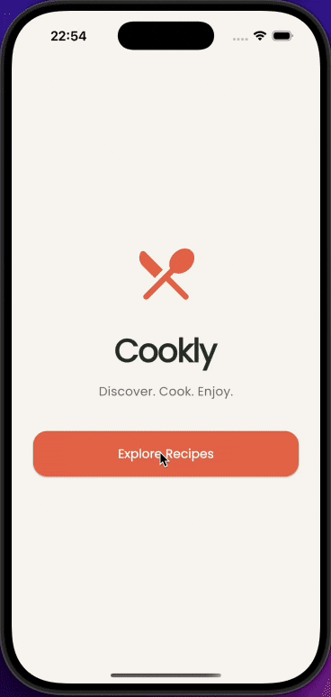
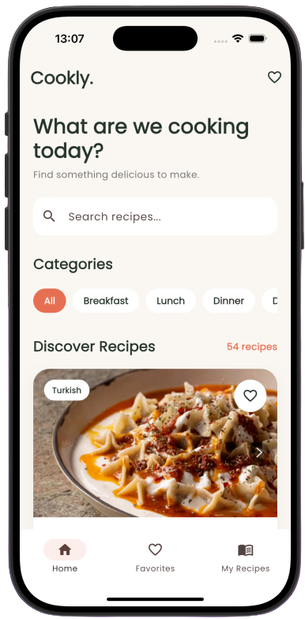
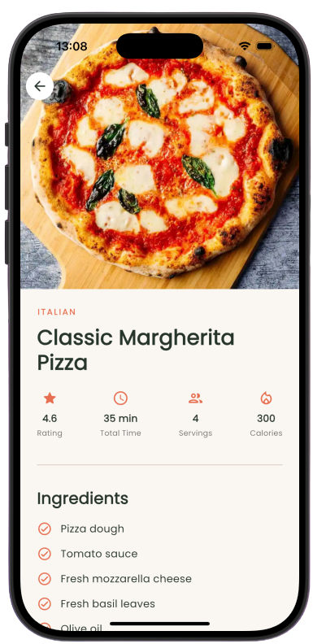
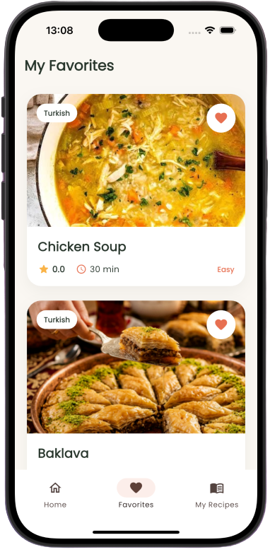
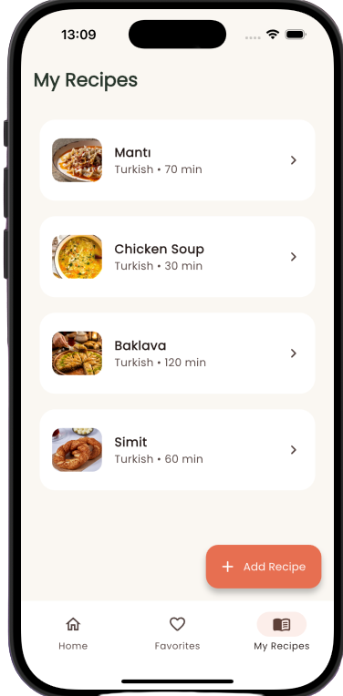
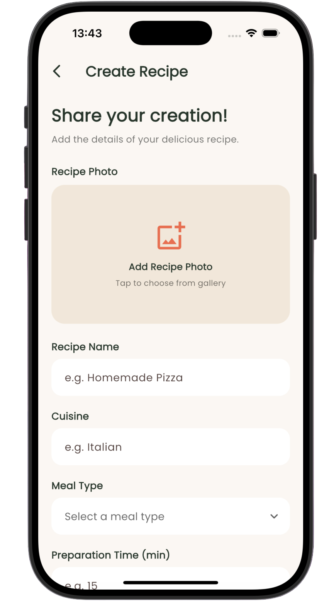

# 🍝 Cookly — Recipe Discovery & Management App

Cookly is a Flutter mobile application designed to make discovering, saving, and managing recipes simple and enjoyable.

The app combines recipes retrieved from the **DummyJSON API** with user-created recipes stored locally, offering a personalized cooking experience through a clean and intuitive interface.

## 🎬 App Demo

<p align="center">    </p>

## 📱 Screenshots

<p align="center">
  
  
  
  
  
</p>

## ✨ Features

* **Recipe Discovery:** Browse recipes fetched from the DummyJSON API.
* **Search & Filtering:** Search recipes by name and filter them by meal category.
* **Recipe Details:** View ingredients, step-by-step instructions, cooking time, servings, difficulty, and other recipe information.
* **Favorites:** Add and remove recipes from favorites, including custom recipes.
* **Recipe Management:** Create, view, edit, and delete personal recipes.
* **Photo Selection:** Select recipe images from the device gallery.
* **Local Persistence:** Store personal recipes and favorites locally using SharedPreferences.
* **Responsive UI:** Enjoy a modern, card-based interface with intuitive navigation.
* **Error & Loading States:** Display loading indicators and informative messages when data is unavailable.

## 🛠️ Tech Stack


| Technology        | Purpose                            |
| ----------------- | ---------------------------------- |
| Flutter & Dart    | Cross-platform mobile development  |
| Material Design   | UI components and styling          |
| DummyJSON API     | Online recipe data                 |
| HTTP              | REST API requests                  |
| SharedPreferences | Local recipe and favorites storage |
| Image Picker      | Selecting photos from the gallery  |
| Path Provider     | Managing local image files         |

## 📂 Project Structure

```
lib/
├── main.dart
├── models/
│   └── recipe_model.dart
├── screens/
│   ├── home_screen.dart
│   ├── favorites_screen.dart
│   ├── my_recipes_screen.dart
│   ├── recipe_detail_screen.dart
│   ├── recipe_form_screen.dart
│   └── main_navigation_screen.dart
├── services/
│   ├── api_service.dart
│   ├── local_storage_service.dart
│   └── image_storage_service.dart
├── widgets/
│   ├── recipe_card.dart
│   ├── recipe_image.dart
│   ├── recipe_info_item.dart
│   ├── recipe_form_field.dart
│   ├── recipe_dropdown_field.dart
│   └── recipe_photo_picker.dart
└── theme/
    └── app_theme.dart
```

## 🚀 Getting Started

### Prerequisites

* Flutter SDK (developed with **Flutter 3.47.6**)
* Dart SDK
* Visual Studio Code or Android Studio
* An iOS Simulator, Android Emulator, or physical device

### Installation

**1. Clone the repository**

```
git clone https://github.com/YOUR_USERNAME/cookly_flutter.git
cd cookly_flutter
```

**2. Install dependencies**

```
flutter pub get
```

**3. Run the application**

```
flutter run
```

### Run Tests

```
flutter test
```

### Analyze Code

```
flutter analyze
```

## 🌐 API

Cookly uses the public [DummyJSON Recipes API](https://dummyjson.com/recipes) to retrieve recipe data.

API recipes are read-only. User-created recipes and favorites are stored locally on the device and are not uploaded to the API.

## 🧪 Development & Testing

* Developed using Flutter 3.47.6.
* Tested on the iOS Simulator.
* Recipe model serialization and deserialization tests implemented using `<span>flutter_test</span>`.
* Android emulator testing is planned.

## 🎓 Project Background

Cookly was developed as part of a Flutter mobile application development course.

The project demonstrates core concepts such as stateful and stateless widgets, navigation, JSON parsing, API integration, reusable widgets, form handling, state management, and local data persistence.

## 📄 License

This project was created for educational and portfolio purposes.
